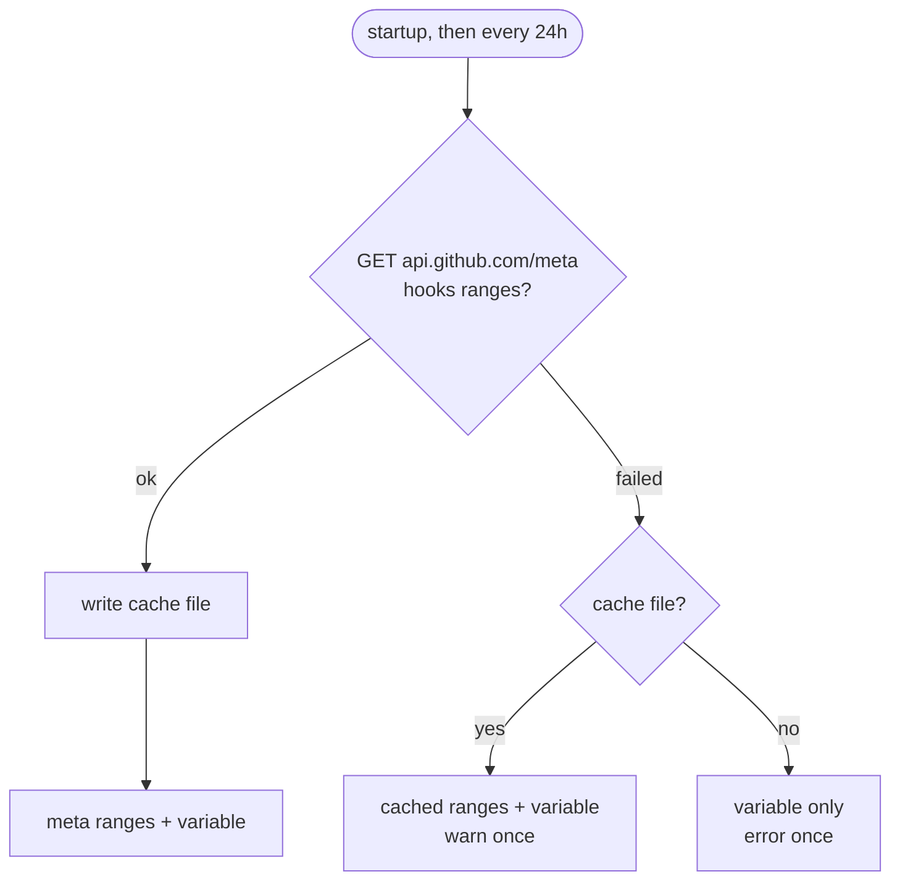

# Webhook transport hardening runbook (SPEC-201)

This runbook documents how to deploy the webhook ingress so that the only network
path to the handler is: TLS terminated by a reverse proxy on loopback, forwarded
over a single trusted hop, from an allowlisted platform IP range. It also documents
the token rotation/revocation procedure (AC9) and the root trust assumption (AC10).

## Configuration

The app reads these environment values for the transport guard:

| Variable | Meaning | Default |
|---|---|---|
| `WEBHOOK_TRUSTED_HOP` | The single hop (loopback proxy address) the app accepts connections from | `127.0.0.1` |
| `WEBHOOK_ALLOWED_CIDR_RANGES` | Comma-separated IPv4 or IPv6 CIDR ranges you maintain: GitLab, relays, private ranges. On the GitHub route they are **added** to the ranges read from GitHub meta | empty |
| `WEBHOOK_ALLOWLIST_MODE` | `auto`: GitHub sender ranges are read from GitHub meta. `manual`: only `WEBHOOK_ALLOWED_CIDR_RANGES` is used, no network call | `auto` |
| `GITLAB_WEBHOOK_TOKEN` | The shared webhook token, re-read on every verification | (required) |

Which ranges each route accepts:

| Route | `auto` mode (default) | `manual` mode |
|---|---|---|
| `/webhooks/github` | GitHub meta `hooks` ranges + `WEBHOOK_ALLOWED_CIDR_RANGES` | `WEBHOOK_ALLOWED_CIDR_RANGES` |
| `/webhooks/gitlab` | `WEBHOOK_ALLOWED_CIDR_RANGES` | `WEBHOOK_ALLOWED_CIDR_RANGES` |

GitHub ranges are never added to the GitLab route: GitLab publishes no
machine-readable list, and widening the GitLab route to GitHub's shared SaaS
ranges would buy nothing.

The app binds to loopback only; TLS is terminated at the proxy. `trust proxy`
is scoped to `WEBHOOK_TRUSTED_HOP` (never `true`, never a broad subnet). The
accept/reject decision is taken solely by the transport guard from the raw socket
address and explicit `X-Forwarded-Proto` / `X-Forwarded-For` headers — never from
framework-derived `req.protocol` / `req.ip`.

## GitHub sender ranges: read from GitHub meta

GitHub adds webhook sender ranges over time. A hand-written list ages silently:
in November 2026, three new ranges (`9.234.106.48/28`, `9.234.98.160/28`,
`9.234.98.176/28`) were missing and about one GitHub webhook in three was
rejected `off-allowlist` for weeks.

In `auto` mode the server therefore resolves the GitHub allowlist itself:



| Situation | GitHub route allowlist | Log |
|---|---|---|
| GitHub meta answers | meta `hooks` + variable; cache rewritten | `info` on each refresh |
| meta fails, cache present | cached `hooks` + variable | one `warn` with the reason and the cache date |
| meta fails, no cache | variable only | one `error` naming `WEBHOOK_ALLOWED_CIDR_RANGES` |
| `WEBHOOK_ALLOWLIST_MODE=manual` | variable only, no network call | one `info` at startup |

Degraded states are logged when they start, not on every refresh. A refresh that
succeeds again logs at `info`.

- **Source:** `https://api.github.com/meta`, field `hooks`, unauthenticated
  (one call a day, far below the 60/hour anonymous rate limit), 10 s timeout,
  no redirect followed, body capped at 2 MB.
- **Validation:** every `hooks` entry must be a well-formed CIDR range no broader
  than `/16` (IPv4) or `/24` (IPv6); GitHub publishes `/20` to `/32`. One invalid
  or too broad entry rejects the whole answer: it counts as a failed read, the
  previous cache is kept, and the `warn`/`error` line names the offending range.
- **Startup:** the first resolution finishes before the server listens, so a
  restart never opens a window with a partial list.
- **Cache file:** `github-hook-ranges.json` in the ReviewFlow config directory
  (`~/Library/Application Support/reviewflow/` on macOS,
  `$XDG_CONFIG_HOME/reviewflow/` or `~/.config/reviewflow/` on Linux). Deleting it
  is safe; it is rewritten on the next successful read. It is written atomically
  with mode `0600`. A corrupt file, or one holding an invalid or too broad range,
  counts as no cache and logs one `warn` with the file path and the reason.
- **Refresh period:** 24 h. A new GitHub range is accepted at the latest one day
  after GitHub publishes it, or right after a restart.

### IPv6

The CIDR matcher handles both IPv4 and IPv6 (GitHub publishes `2a0a:a440::/29`
and `2606:50c0::/32`). An address only matches a range of its own family. An
IPv4-mapped IPv6 address (`::ffff:192.30.252.1`, what nginx writes on a
dual-stack socket) is compared as the IPv4 address it carries.

### Diagnosing a refused webhook

Each transport guard refusal writes one `warn` line. Per route, per reason and
per minute, each source address (`clientIp`, or `socketAddress` when there is
none) is logged once, for at most 32 distinct addresses: a scanner repeating
from one address cannot hide the first refusal of a GitHub address. The first
line of the next minute adds `suppressedInPreviousWindow` with the number of
refusals not logged. Addresses
longer than 64 characters are truncated and their original length is added as
`clientIpLength` or `socketAddressLength`.

```json
{"level":40,"reason":"off-allowlist","clientIp":"9.234.106.50","socketAddress":"127.0.0.1","msg":"Webhook rejected by transport guard"}
```

- `reason: off-allowlist` with a GitHub address: check the logs for the GitHub
  meta `warn`/`error` lines above, then compare `clientIp` with the `hooks` field
  of `https://api.github.com/meta`.
- `reason: untrusted-socket`: the connection did not come from
  `WEBHOOK_TRUSTED_HOP`.
- `reason: non-https`: the proxy did not set `X-Forwarded-Proto: https`.

## Reverse proxy: bind app to loopback

Run the app with the listener reachable only from the proxy (loopback). The proxy
must set `X-Forwarded-Proto` itself and must NOT pass a client-supplied value
through.

### nginx

```nginx
server {
  listen 443 ssl;
  server_name reviewflow.example.com;

  ssl_certificate     /etc/letsencrypt/live/reviewflow.example.com/fullchain.pem;
  ssl_certificate_key /etc/letsencrypt/live/reviewflow.example.com/privkey.pem;

  location /webhooks/ {
    proxy_pass http://127.0.0.1:3000;
    proxy_set_header Host              $host;
    # Set by the proxy; never trust a client-supplied value.
    proxy_set_header X-Forwarded-Proto https;
    proxy_set_header X-Forwarded-For   $remote_addr;
  }
}
```

### Caddy

```caddy
reviewflow.example.com {
  reverse_proxy /webhooks/* 127.0.0.1:3000 {
    header_up X-Forwarded-Proto https
    header_up X-Forwarded-For {remote_host}
  }
}
```

### Traefik (dynamic config)

```yaml
http:
  routers:
    reviewflow-webhooks:
      rule: "Host(`reviewflow.example.com`) && PathPrefix(`/webhooks/`)"
      entryPoints: [websecure]
      tls: {}
      service: reviewflow
  services:
    reviewflow:
      loadBalancer:
        servers:
          - url: "http://127.0.0.1:3000"
        # Traefik sets X-Forwarded-* from the connection; ensure the entrypoint
        # forwardedHeaders.trustedIPs is the proxy hop only, never the client.
```

## Token rotation / revocation (AC9)

`GITLAB_WEBHOOK_TOKEN` is re-read from the environment on every verification, so
the secret can be rotated **without redeploying or restarting** the process.
Comparison is uniformly constant-time (`timingSafeEqual` over fixed-length digests);
there is no length-based short circuit that could leak token length.

Rotation cadence: rotate on a fixed schedule (at least quarterly) and immediately
on any suspected leak.

Procedure to rotate (and to revoke a compromised token):

1. Generate a new high-entropy token.
2. Update `GITLAB_WEBHOOK_TOKEN` in the process environment and refresh it
   (e.g. `systemctl set-environment` + reload, or update the secret store and
   trigger an env refresh) — no redeploy required.
3. Update the GitLab webhook secret token to the new value.
4. The old token is immediately invalid: the next verification reads the new value.

## Root trust assumption (AC10)

GitLab does not sign the webhook body. Therefore **token confidentiality is the
root trust assumption** of the entire webhook surface. Identity fields in the
payload (e.g. `event.user.id`) are trusted **only transitively via token
possession** — they are not independently verified. Any field that requires
stronger assurance MUST be re-fetched from an authenticated GitLab API call
(the `threadFetchGateway.fetchThreads` trusted-source pattern, cf. SPEC-196 AC9 /
SPEC-198 AC-10), never read from the webhook body.

Transport hardening is a necessary but not sufficient condition for trust:
- The IP allowlist bounds probability, not impact, and is a secondary defense; on
  shared SaaS ranges it proves nothing about which project sent the webhook.
- Actor authenticity / confused-deputy control is SPEC-197.
- Replay protection (`X-Gitlab-Event-UUID` de-duplication) is SPEC-200; a perfect
  replay survives every transport guard.

Because SPEC-197 is inoperative if the token leaks, the rotation/revocation
procedure above (AC9) is load-bearing, not cosmetic.
